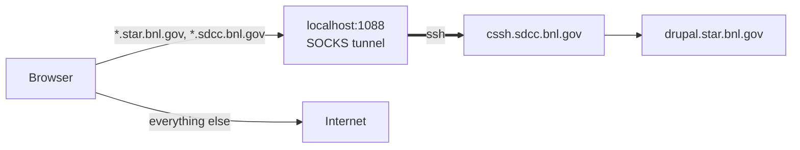
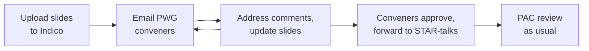

# Drupal access and STAR talks on Indico
{: .no_toc }

{: .warning }
> Drupal (`drupal.star.bnl.gov`) is no longer publicly reachable — it works **only through an SSH tunnel** to SDCC.
> STAR presentations are moving to InvenioRDM; **until then, upload talks to Indico** (see [below](#2-star-talks-on-indico-transition-period)).

## Table of contents
{: .no_toc .text-delta }

1. TOC
{:toc}

---

## 1. Accessing Drupal through an SSH tunnel

You open an SSH connection to the SDCC gateway that acts as a SOCKS proxy on your computer (`localhost:1088`).
A small PAC file tells the browser to send **only BNL pages** through it — everything else goes directly.



**You need:** an SDCC account and an SSH key that already works for the SDCC gateway (see [SSH](/software/ssh/)).

### Step 1 — open the tunnel

The same command works on **Linux, macOS and WSL**:

```bash
ssh -C -N -D 1088 <sdcc_user>@cssh.sdcc.bnl.gov
```

Keep the terminal open. No output means it is working; `Ctrl+C` closes the tunnel.

<details markdown="1">
<summary>Optional: shortcut in <code>~/.ssh/config</code></summary>

```
Host star-socks
    HostName cssh.sdcc.bnl.gov
    User <sdcc_user>
    DynamicForward 127.0.0.1:1088
    Compression yes
    RequestTTY no
    ServerAliveInterval 60
```

Then the tunnel is just `ssh -N star-socks`.
</details>

{: .note }
> **WSL users:** run the command inside WSL (where your key is). Windows browsers still reach `localhost:1088` thanks to WSL2 localhost forwarding.
> Check from PowerShell: `Test-NetConnection 127.0.0.1 -Port 1088` → `TcpTestSucceeded : True`.
> If it is `False`, add `networkingMode=mirrored` under `[wsl2]` in `%USERPROFILE%\.wslconfig` and run `wsl --shutdown`.

### Step 2 — point the browser to the PAC file

PAC URL (uses port 1088):

```
https://www4.rcf.bnl.gov/~geurts/configs/star.pac
```

**Firefox (any OS):** Settings → General → Network Settings → **Settings…**

```
Connection Settings
  ( ) No proxy
  ( ) Auto-detect proxy settings for this network
  ( ) Use system proxy settings
  ( ) Manual proxy configuration
  (•) Automatic proxy configuration URL
      [ https://www4.rcf.bnl.gov/~geurts/configs/star.pac ]  [Reload]
                                                               [ OK ]
```

**Chrome (any OS):** Chrome has no proxy settings of its own. The simplest way is a separate Chrome window started with the PAC URL — it does not touch your normal Chrome or system settings:

| OS | Command |
|:--|:--|
| Windows (WSL) | Create a desktop shortcut (right click → New → Shortcut) with the target below |
| macOS | `open -na "Google Chrome" --args --user-data-dir="$HOME/.chrome-star" --proxy-pac-url=https://www4.rcf.bnl.gov/~geurts/configs/star.pac https://drupal.star.bnl.gov/STAR/` |
| Linux | `google-chrome --user-data-dir="$HOME/.chrome-star" --proxy-pac-url=https://www4.rcf.bnl.gov/~geurts/configs/star.pac https://drupal.star.bnl.gov/STAR/` |

Windows shortcut target (one line, replace `<you>` with your Windows user name):

```
"C:\Program Files\Google\Chrome\Application\chrome.exe" --user-data-dir="C:\Users\<you>\AppData\Local\Google\Chrome STAR" --proxy-pac-url=https://www4.rcf.bnl.gov/~geurts/configs/star.pac https://drupal.star.bnl.gov/STAR/
```

{: .note }
The separate `--user-data-dir` matters: if Chrome is already open, flags given to a new window of the *same* profile are ignored.
Check that the PAC is active at `chrome://net-internals/#proxy`.

**Edge / Safari / other apps** use the system setting (this applies to Chrome too if you prefer it over the separate window):

| OS | Where |
|:--|:--|
| Windows (WSL) | Settings → Network & internet → Proxy → *Use setup script* → On, paste the URL |
| macOS | System Settings → Network → Wi-Fi → Details… → Proxies → *Automatic proxy configuration*, paste the URL |
| Linux (GNOME) | Settings → Network → Network Proxy → *Automatic*, paste the URL |

{: .warning }
Do **not** set a manual SOCKS proxy `localhost:1088` — that sends *all* your traffic through BNL.

### Step 3 — open Drupal

<https://drupal.star.bnl.gov/STAR/>

### Troubleshooting

| Symptom | Fix |
|:--|:--|
| `503 Service Unavailable` | The tunnel is not running → repeat Step 1 (it also drops after sleep or a network change). Then `Ctrl+Shift+R`. |
| `bind [127.0.0.1]:1088: Address already in use` | A tunnel is already open — just use it, or close the old terminal. |
| `Permission denied (publickey)` | Your key is not registered at SDCC → see [SSH](/software/ssh/). |
| Only some BNL pages fail to load | Firefox: `about:config` → `network.proxy.socks_remote_dns` = `true`. |
| Chrome ignores the proxy | Another Chrome with the same `--user-data-dir` is already running — close it, or use a different folder. |

<details markdown="1">
<summary>Using your own PAC file instead (e.g. a different port)</summary>

Save as `star.pac` and use `file:///path/to/star.pac` (Windows: `file:///C:/Users/<you>/star.pac`) as the PAC URL:

```js
function FindProxyForURL(url, host) {
  if (dnsDomainIs(host, ".star.bnl.gov") || dnsDomainIs(host, ".sdcc.bnl.gov"))
    return "SOCKS5 127.0.0.1:1088; SOCKS 127.0.0.1:1088; DIRECT";
  return "DIRECT";
}
```
</details>

---

## 2. STAR talks on Indico (transition period)

While Drupal is closed and InvenioRDM is not ready yet, presentation materials are uploaded to **Indico** and reviewed from there.



### A. Upload your slides

1. Open the STAR category: <https://indico.bnl.gov/category/801/>.
   No access? Register through CoManage — instructions in the Mattermost channel [Indico – phonebook integration](https://chat.sdcc.bnl.gov/star/channels/indico--phonebook-integration).
2. Find the **conference** and your **PWG**. If it does not exist, ask your PWG conveners and the PAC to create it.
3. Open the PWG event → **pencil icon** (top center) → **Timetable** → **Add new** → **Contribution**.
4. Title: **`Your Name: Talk title`**, e.g. `John Doe: Measurement of ...`
5. **Save** → **Switch to display view**.
6. **Pencil icon with square background** next to your talk → **Material Editor** → upload the slides.

```
indico.bnl.gov/category/801   (STAR)
└── <Conference>, e.g. Quark Matter 2027
    └── <PWG>, e.g. Hard Probes
        ✎ ▸ Timetable ▸ Add new ▸ Contribution
            Title: "John Doe: Measurement of ..."
            [Save] ▸ Switch to display view
        ✎ (next to your talk) ▸ Material Editor ▸ upload slides
```

Example of a filled page: <https://indico.bnl.gov/event/35219/>

### B. Request the review

1. Email your PWG conveners — subject **exactly** in this form, with the Indico link inside:

   ```
   To:      <PWG conveners>
   Subject: STAR presentation by John Doe for Quark Matter 2027 submitted for review

   Dear conveners,

   my slides for Quark Matter 2027 are uploaded to Indico:
   https://indico.bnl.gov/event/<event-id>/contributions/<contribution-id>/

   Best regards,
   John Doe
   ```

2. Address the reviewers' comments and update the slides on Indico.
3. When the conveners approve, they forward the email to **STAR-talks** (this documents the PWG sign-off).
4. The **PAC** then reviews the talk as usual.

{: .note }
These are temporary arrangements until the move to InvenioRDM is finished.
