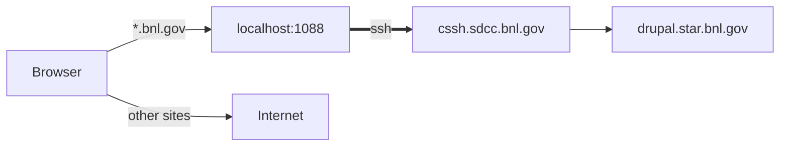
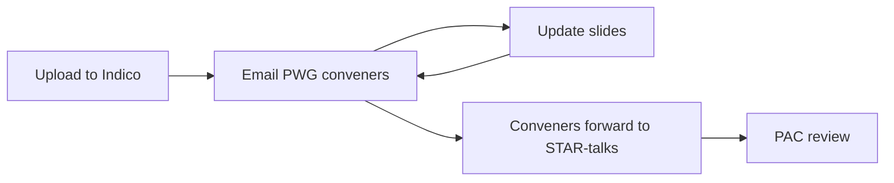

# Drupal access and talks on Indico
{: .no_toc }

{: .warning }
Drupal is reachable only through an SSH tunnel to SDCC. Until STAR moves to InvenioRDM, talks for review go to [Indico](#2-talks-on-indico).

1. TOC
{:toc}

## 1. Drupal through an SSH tunnel

The tunnel opens a SOCKS proxy on `localhost:1088`. A [PAC file](https://www4.rcf.bnl.gov/~geurts/configs/star.pac) tells the browser to send only BNL addresses through it.



You need an SDCC account and a working [SSH key](/software/ssh/).

### Open the tunnel

Linux, macOS and WSL:

```bash
ssh -C -N -D 1088 <sdcc_user>@cssh.sdcc.bnl.gov
```

Keep the terminal open; `Ctrl+C` closes the tunnel.

<details markdown="1">
<summary>Shortcut in <code>~/.ssh/config</code></summary>

```
Host star-socks
    HostName cssh.sdcc.bnl.gov
    User <sdcc_user>
    DynamicForward 127.0.0.1:1088
    Compression yes
    ServerAliveInterval 60
```

Then run `ssh -N star-socks`.
</details>

{: .note }
WSL: run the command inside [WSL](/software/wsl). Windows browsers reach it as `localhost:1088`; check with `Test-NetConnection 127.0.0.1 -Port 1088` in PowerShell.

### Set up the browser

PAC URL: `https://www4.rcf.bnl.gov/~geurts/configs/star.pac`

**Firefox:** Settings → Network Settings → Settings… → *Automatic proxy configuration URL* → paste the URL → Reload → OK ([Mozilla help](https://support.mozilla.org/kb/connection-settings-firefox)).

**Chrome** has no proxy setting of its own. Start a separate window with the PAC URL; the separate `--user-data-dir` is needed if Chrome is already running.

Windows (desktop shortcut target, replace `<you>`):

```
"C:\Program Files\Google\Chrome\Application\chrome.exe" --user-data-dir="C:\Users\<you>\AppData\Local\Google\Chrome STAR" --proxy-pac-url=https://www4.rcf.bnl.gov/~geurts/configs/star.pac
```

macOS:

```bash
open -na "Google Chrome" --args --user-data-dir="$HOME/.chrome-star" --proxy-pac-url=https://www4.rcf.bnl.gov/~geurts/configs/star.pac
```

Linux:

```bash
google-chrome --user-data-dir="$HOME/.chrome-star" --proxy-pac-url=https://www4.rcf.bnl.gov/~geurts/configs/star.pac
```

**Other browsers** use the system proxy: on Windows *Settings → Network & internet → Proxy → Use setup script*, on macOS *Network → Details → Proxies → Automatic proxy configuration*, on GNOME *Network → Network Proxy → Automatic*.

{: .warning }
Do not set `localhost:1088` as a manual SOCKS proxy: that sends all your traffic through BNL.

Then open <https://drupal.star.bnl.gov/STAR/>.

### Troubleshooting

| Problem | Fix |
|:--|:--|
| `503 Service Unavailable` | The tunnel is not running. Start it again (it drops after sleep or a network change). |
| `Address already in use` | A tunnel is already open. |
| `Permission denied (publickey)` | Your key is not registered at SDCC, see [SSH](/software/ssh/). |
| Chrome ignores the proxy | Another Chrome with the same `--user-data-dir` is open. |

## 2. Talks on Indico

Temporary procedure until InvenioRDM is ready.



### Upload the slides

1. Open the [STAR category on Indico](https://indico.bnl.gov/category/801/). If you have no access, register through CoManage ([instructions on Mattermost](https://chat.sdcc.bnl.gov/star/channels/indico--phonebook-integration)).
2. Open the conference and your PWG. If they are missing, ask the PWG conveners and the PAC to create them.
3. Click the pencil icon at the top, choose **Timetable**, then **Add new → Contribution**.

   
   

4. Title: `John Doe: Measurement of ...`. Save, then **Switch to display view** (top left).
5. Next to your talk, click the pencil icon with a square background, choose **Material Editor**, then **Upload files**.

   

Example: [indico.bnl.gov/event/35219](https://indico.bnl.gov/event/35219/). Screenshots from [Learning Indico](https://learn.getindico.io/meetings/timetable/#contributions).

### Ask for review

1. Email the PWG conveners:

   ```
   Subject: STAR presentation by John Doe for Quark Matter 2027 submitted for review

   Slides: https://indico.bnl.gov/event/<id>/contributions/<id>/
   ```

2. Update the slides on Indico after the comments.
3. When the conveners approve, they forward the email to STAR-talks. The PAC then reviews the talk as usual.
