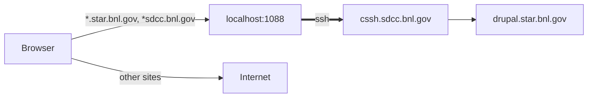
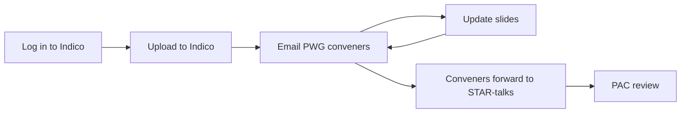
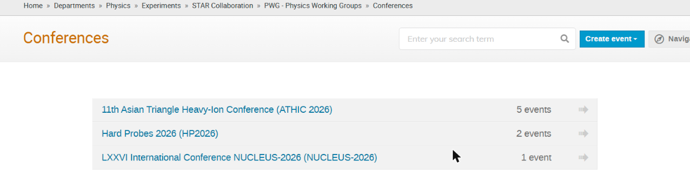
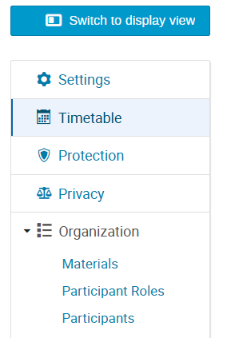
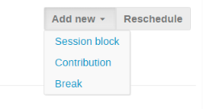
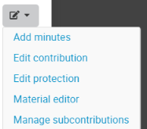
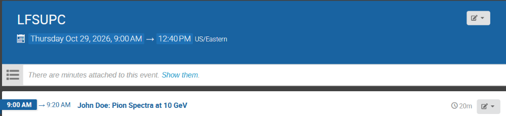

# Drupal access and Indico
{: .no_toc }

{: .warning }
Drupal is reachable only through an SSH tunnel to SDCC. Until STAR moves to InvenioRDM, talks and proceedings for review go to [Indico](#2-talks-on-indico).

1. TOC
{:toc}

## 1. Drupal through an SSH tunnel

The tunnel opens a SOCKS proxy on `localhost:1088`. A [PAC file](https://www4.rcf.bnl.gov/~geurts/configs/star.pac) tells the browser to send only STAR and SDCC addresses through it.



You need an SDCC account and a working [SSH key](/software/ssh/).

### Open the tunnel

Linux, macOS and WSL:

```bash
ssh -C -N -D 1088 <sdcc_user>@cssh.sdcc.bnl.gov
```

Keep the terminal open.

<details markdown="1">
<summary>Shortcut in <code>~/.ssh/config</code></summary>

```
Host star-socks
    HostName cssh.sdcc.bnl.gov
    User <sdcc_user>
    DynamicForward 127.0.0.1:1088
    Compression yes
    ServerAliveInterval 60
```

Then run `ssh -N star-socks`.
</details>

{: .note }
WSL: run the command inside [WSL](/software/wsl). Windows browsers reach it as `localhost:1088`; check with `Test-NetConnection 127.0.0.1 -Port 1088` in PowerShell.

### Set up the browser

PAC URL: [`https://www4.rcf.bnl.gov/~geurts/configs/star.pac`](https://www4.rcf.bnl.gov/~geurts/configs/star.pac)

{: .note }
The PAC file is in a personal directory, so read it before using it. It should only send `*.star.bnl.gov` and `*sdcc.bnl.gov` to `127.0.0.1:1088` and everything else `DIRECT`. The port must match the `-D 1088` of the tunnel.

**Firefox:** Settings → Network Settings → Settings… → *Automatic proxy configuration URL* → paste the URL → Reload → OK ([Mozilla help](https://support.mozilla.org/kb/connection-settings-firefox)).

**Chrome** has no proxy setting of its own. Start a separate window with the PAC URL; the separate `--user-data-dir` is needed if Chrome is already running.

Windows (desktop shortcut target, replace `<you>`):

```
"C:\Program Files\Google\Chrome\Application\chrome.exe" --user-data-dir="C:\Users\<you>\AppData\Local\Google\Chrome STAR" --proxy-pac-url=https://www4.rcf.bnl.gov/~geurts/configs/star.pac
```

macOS:

```bash
open -na "Google Chrome" --args --user-data-dir="$HOME/.chrome-star" --proxy-pac-url=https://www4.rcf.bnl.gov/~geurts/configs/star.pac
```

Linux:

```bash
google-chrome --user-data-dir="$HOME/.chrome-star" --proxy-pac-url=https://www4.rcf.bnl.gov/~geurts/configs/star.pac
```

**Safari** uses the macOS proxy: System Settings → Wi-Fi (or your network) → Details → Proxies → turn on *Automatic proxy configuration* → paste the URL, leave *SOCKS proxy* off → OK. Restart Safari.

**Other browsers** use the system proxy too: on macOS as for Safari, on Windows *Settings → Network & internet → Proxy → Use setup script*, on GNOME *Network → Network Proxy → Automatic*.

{: .warning }
Do not set `localhost:1088` as a manual SOCKS proxy: all traffic then goes to BNL, and sites outside BNL stop loading.

Then open <https://drupal.star.bnl.gov/STAR/>.

### Troubleshooting

| Problem | Fix |
|:--|:--|
| `503 Service Unavailable` | The tunnel is not running. Start it again (it drops after sleep or a network change). |
| `Address already in use` | A tunnel is already open. |
| `Permission denied (publickey)` | Your key is not registered at SDCC, see [SSH](/software/ssh/). |
| Chrome ignores the proxy | Another Chrome with the same `--user-data-dir` is open. |

## 2. Talks on Indico



### Log in to Indico

STAR events on [indico.bnl.gov](https://indico.bnl.gov) are visible only to STAR members. Access comes from the STAR PhoneBook, matched to your Indico account through ORCID.

1. [Register with CoManage](https://docs.sdcc.bnl.gov/services/comanage/Register_for_SCDF_COmanage/). Use your BNL/SDCC account as the first identity if you have one.
2. [Add your ORCID](https://docs.sdcc.bnl.gov/services/comanage/Add_ORCID_to_COperson/) to the CoManage entry.
3. Log in to Indico with the **CILogon** button (*Federated Authentication* does not pass the ORCID), accept the account merge if asked, then log out.
4. PhoneBook syncs to Indico every hour at 20 minutes past. After the next sync, log in again with CILogon in a private window and open the [test event](https://indico.bnl.gov/event/34407/). If it opens, you are done.

#### Indico login problems

| Problem | Fix |
|:--|:--|
| `Access Denied` on the test event | Redo steps 3 and 4 in this order: CILogon login, wait for the next sync, log out and in again in a private window. |
| Still `Access Denied` a few hours later | Your PhoneBook record has no ORCID, or its email differs from the one in Indico, or you have duplicate Indico accounts. Ask in the [Mattermost channel](https://chat.sdcc.bnl.gov/star/channels/indico--phonebook-integration). |
| `The identifier "http://cilogon.org/..." is not registered` | You picked a different identity provider than the one you enrolled with, or the enrollment is not approved yet (about one business day). Use the provider you enrolled with and do not enroll again. |
| `You do not have any current roles` | Enrollment is waiting for approval. Wait for the confirmation email. |
| Link in the CoManage email gives `404 Not Found` | Write to [RT-RACF-UserAccounts@bnl.gov](mailto:RT-RACF-UserAccounts@bnl.gov). |
| SDCC login asks for a one-time code | The code comes from your authenticator app, not email. [Reset MFA](https://docs.sdcc.bnl.gov/access/authentication/mfa-deletion/) or [enroll a new one](https://account.sdcc.bnl.gov/otpenroll). |
| `File not found` after the SDCC login, `mismatching_state`, `KeyError: 'email'` | Retry in a private window. If it persists, ask in the channel. |
| Test event opens, but some other events do not | Your access works; those events are restricted by their organizers. |

### Upload the slides

1. Open the [STAR conferences category](https://indico.bnl.gov/category/801/), then the conference and your PWG. If they are missing, ask the PWG conveners and the PAC to create them.

   

2. Click the pencil icon in the top toolbar (*Switch to the management area*), then **Timetable**.

   
   

3. **Add new → Contribution**. Title: `John Doe: Measurement of ...`. Save, then **Switch to display view**.

   

4. Next to your talk, open the pencil menu, choose **Material editor** and upload the slides.

   

The result looks like this ([example event](https://indico.bnl.gov/event/35219/)):



### Ask for review

1. Email the PWG conveners:

   ```
   Subject: STAR presentation by John Doe for Quark Matter 2027 submitted for review

   Slides: https://indico.bnl.gov/event/<id>/contributions/<id>/
   ```

2. Update the slides on Indico after the comments.
